## Автоматизированная система управления проектами
Полнофункциональное веб-приложение для управления проектной деятельностью, объединяющее операционное управление задачами и календарно-ресурсное планирование. Система позволяет руководителям проектов контролировать сроки, распределять задачи, отслеживать загрузку сотрудников и анализировать KPI, а исполнителям — работать с задачами в режиме Kanban-доски. Проект разработан в рамках выпускной квалификационной работы (дипломного проекта).

## Скриншоты
### Авторизация
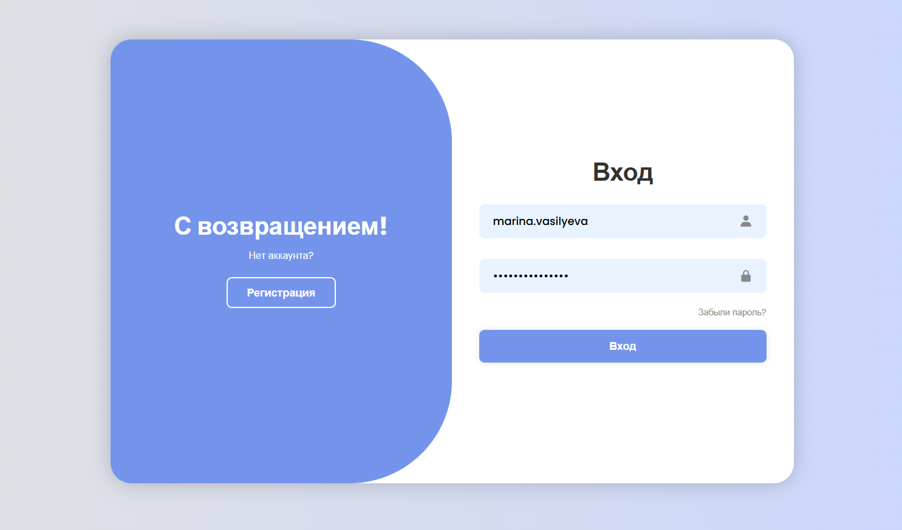

## Модуль календарно-ресурсного планирования. Роль "Руководитель"
### Панель мониторинга
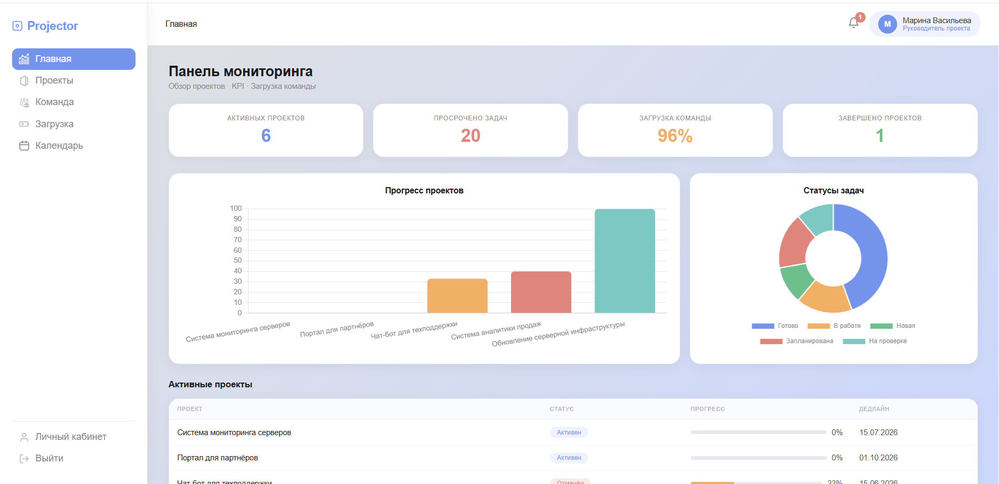
### Панель управления проектами
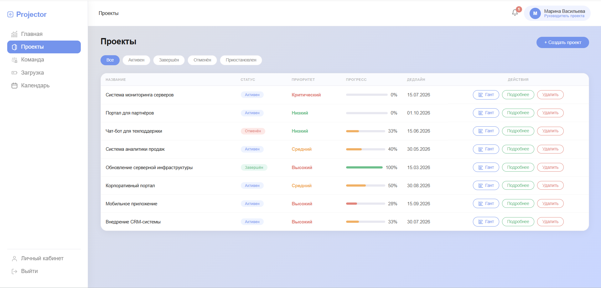
### Страница детальной информации проекта
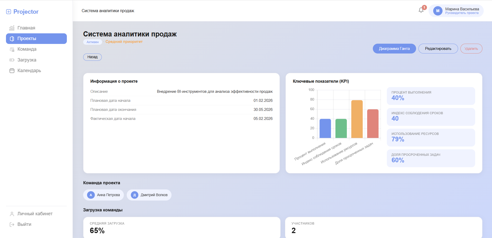
### Диаграмма Ганта проекта
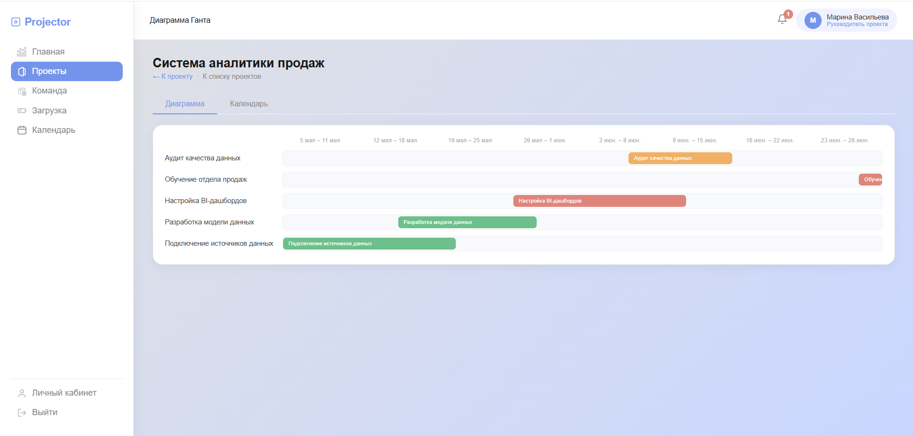
### Календарный план проекта
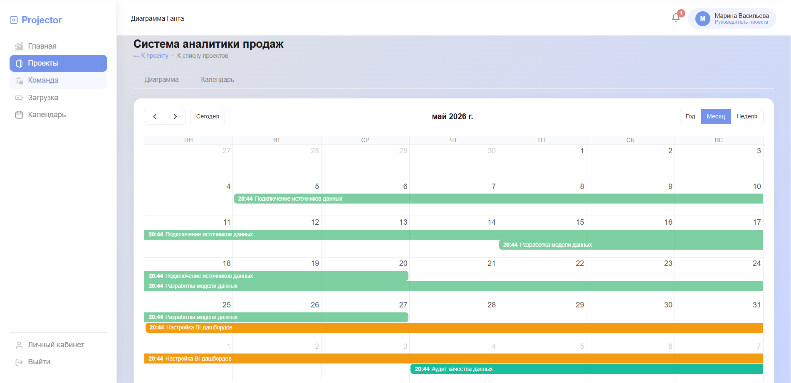
### Команда руководителя
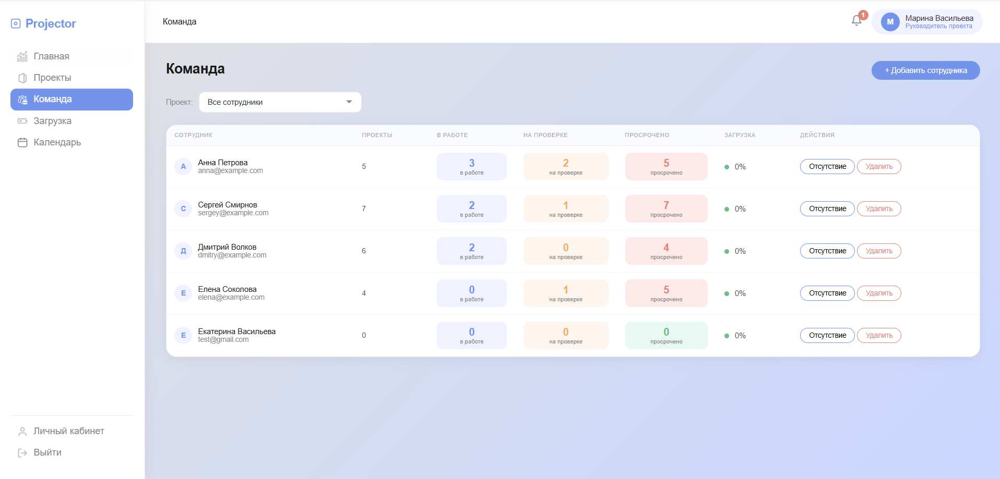
### Страница детальной информации задачи
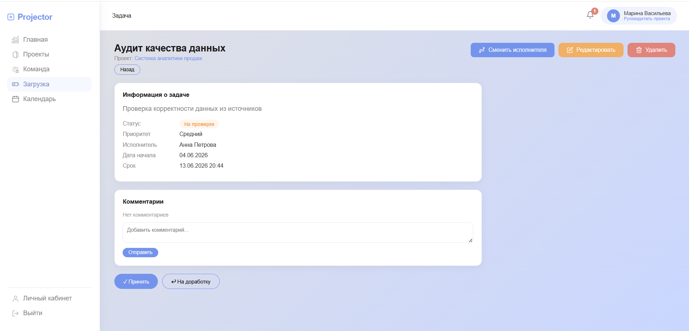
### Полный календарный план задач
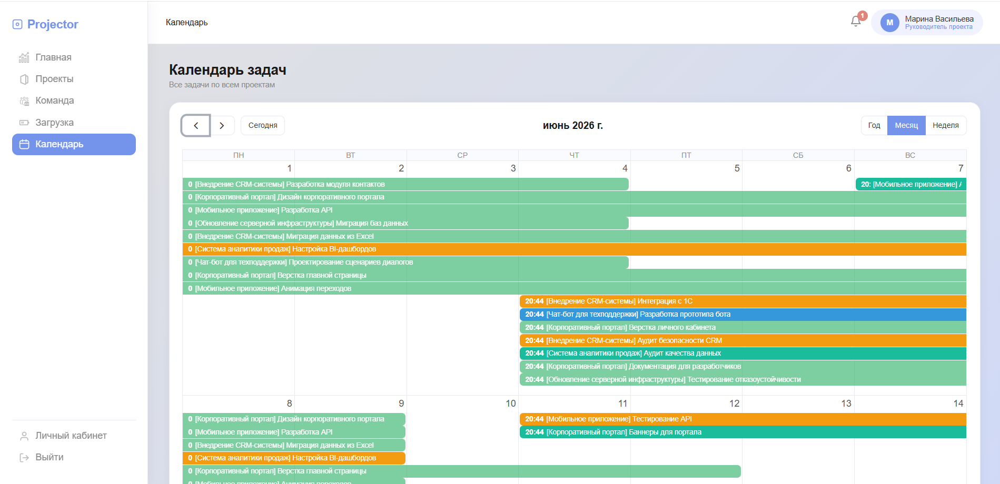
### Панель загрузки команды
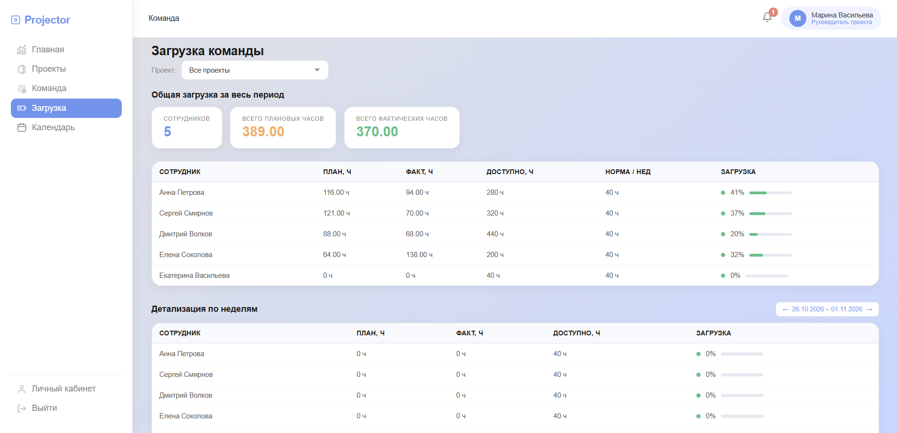
### Уведомления
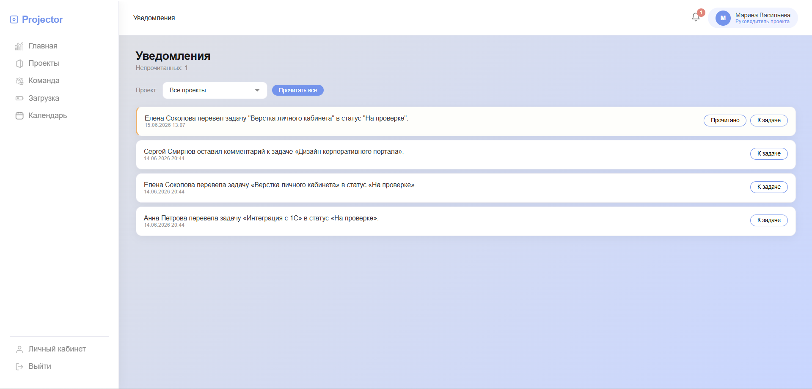

## Модуль операционного управления задачами. Роль "Исполнитель"
### Канбан доска
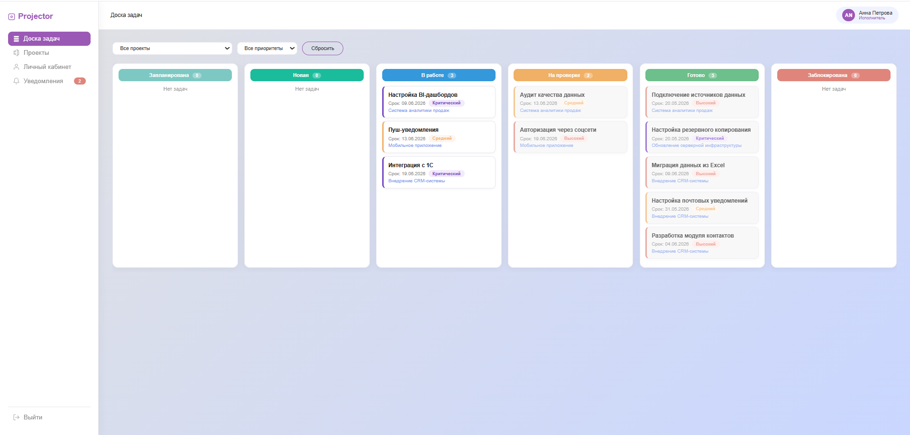
### Проекты
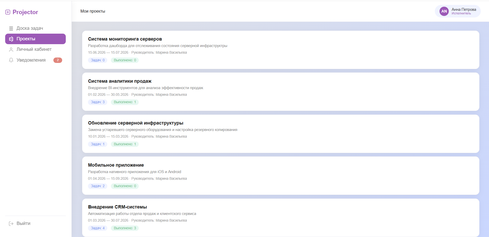
### Личный кабинет
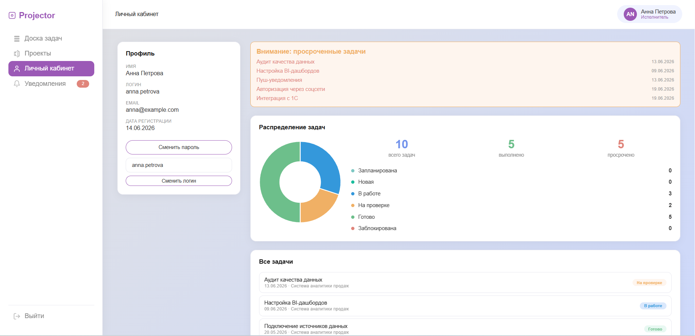
### Личный кабинет
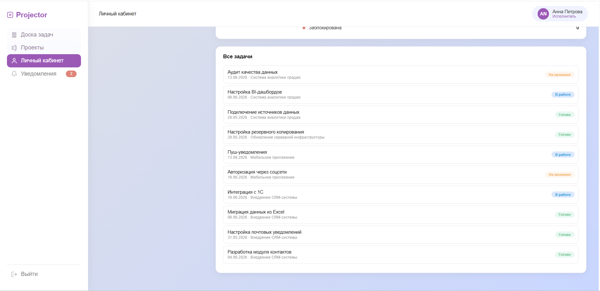
### Уведомления
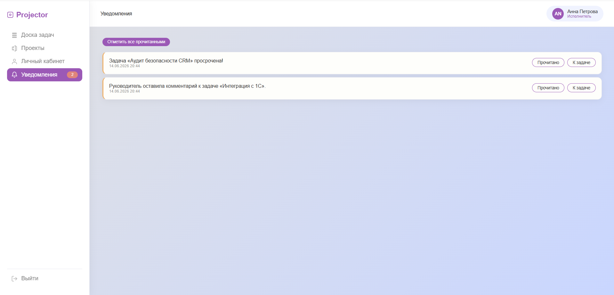
### Страница задачи
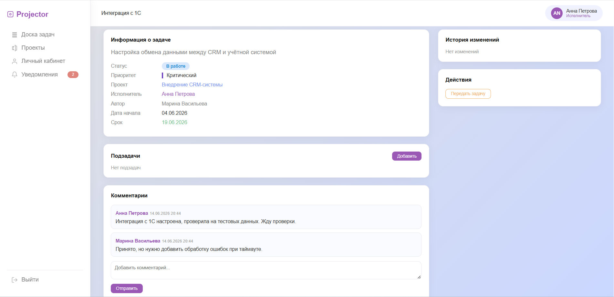

## Стек технологий
- **Backend:** Python 3.13, Django 4.2, Django ORM
- **База данных:** MySQL 8.0
- **Frontend:** HTML5, CSS3, Bootstrap 5, JavaScript
- **Библиотеки визуализации:** Chart.js, FullCalendar

## Архитектура системы

Система построена по клиент-серверному принципу и разделена на два взаимосвязанных модуля, работающих с единой базой данных:
1. **Модуль календарно-ресурсного планирования** (для руководителей) — управление сроками, загрузкой и аналитикой.
2. **Модуль операционного управления задачами** (для исполнителей) — Kanban-доска, статусы, комментарии.


## Ключевой функционал
### 1. Дашборд и аналитика (KPI)
- Сводная панель мониторинга: количество активных и завершенных проектов, просроченные задачи, средняя загрузка команды
- Автоматический расчет KPI по проектам (процент выполнения, индекс соблюдения сроков, утилизация ресурсов)
- Визуализация данных с помощью интерактивных диаграмм (Chart.js)

### 2. Календарно-ресурсное планирование
- **Диаграмма Ганта:** интерактивная временная шкала задач проекта. Возможность создания задач простым выделением диапазона дат на календаре.
- **Умная валидация при создании задач:** 
  - Запрет на создание задач в прошлом.
  - Проверка плановых часов (нельзя запланировать больше часов, чем есть в рабочем периоде).
  - **Учет отпусков и больничных:** система не позволит назначить задачу на сотрудника, если в этот период у него запланировано отсутствие.
  - Предупреждение о перегрузке (система предупредит, если недельная загрузка сотрудника превышает норму, например, 40 часов).

### 3. Операционное управление задачами (Kanban)
- Kanban-доска с drag-and-drop карточек задач
- Механизм подзадач с чек-листом
- Система комментариев и история изменений по каждой задаче
- Запрос на смену исполнителя с подтверждением от руководителя

### 4. Управление загрузкой команды (Workload)
- Сводная таблица загрузки сотрудников с разбивкой по неделям
- **Цветовая индикация:** зеленый (норма), желтый (высокая загрузка), красный (перегрузка)
- Автоматический пересчет доступного фонда времени с учетом отсутствий
- Автоматический расчет фактических трудозатрат при переводе задачи в статус «Готово»

### 5. Уведомления и безопасность
- Встроенная система уведомлений о новых задачах, дедлайнах и смене исполнителей
- Разграничение прав доступа на основе групп пользователей (Руководитель, Исполнитель)
- Защита данных: хеширование паролей (PBKDF2), CSRF-токены, защита от SQL-инъекций через Django ORM

## Структура проекта

```text
projector-app/
├── resource_planning/      # Модуль календарно-ресурсного планирования
│   ├── models.py           # Модели БД (Проекты, Задачи, KPI, Отсутствия)
│   ├── views.py            # Бизнес-логика (Дашборд, Workload, API задач)
│   ├── urls.py
│   └── templates/          # HTML-шаблоны
├── task_management/        # Модуль операционного управления задачами
├── config/                 # Настройки Django
├── fill_db.py              # Скрипт заполнения БД тестовыми данными
├── manage.py
└── requirements.txt
```